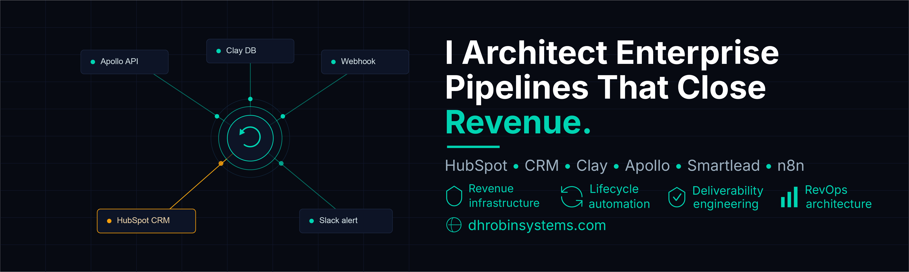
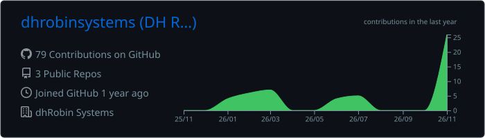
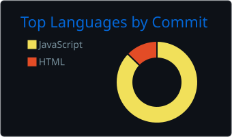
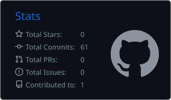

# Hi, I'm DH Robin 👋

## Revenue Infrastructure Architect | HubSpot CRM Architecture | RevOps Automation | GTM Systems

I design and optimize revenue infrastructure that connects CRM platforms, automation workflows, enrichment systems, outbound channels, and operational data into scalable growth systems.

My work focuses on helping teams eliminate fragmented marketing operations by building reliable systems across:

- CRM architecture
- Marketing automation
- Lead lifecycle management
- Data enrichment pipelines
- Outbound infrastructure
- Revenue operations workflows

I combine marketing operations expertise with an engineering mindset to create systems that are measurable, maintainable, and built for scale.

My implementation portfolio and technical documentation are available at **dhRobin Systems**.

---

# What I Build

## CRM & Revenue Operations

- HubSpot CRM architecture and optimization
- Lifecycle stage and pipeline design
- CRM property governance
- Workflow automation
- Lead routing systems
- Revenue reporting infrastructure

## Data & Outbound Infrastructure

- Clay enrichment workflows
- Apollo prospecting systems
- Smartlead outbound infrastructure
- Data validation and enrichment pipelines
- B2B targeting and segmentation systems

## Automation & Integrations

- HubSpot workflow automation
- n8n and Zapier integrations
- API-based system connections
- Marketing operations automation
- GTM process optimization

---

# Professional Experience

## Revenue Infrastructure Architect  
### dhRobin Systems

Designing and implementing revenue infrastructure systems that connect CRM architecture, marketing automation, outbound workflows, data enrichment, and operational processes into scalable GTM systems.

Key areas of work:

- Architecting and optimizing HubSpot CRM structures, pipelines, and lifecycle frameworks
- Building automation workflows that improve lead management and revenue operations
- Designing outbound infrastructure using enrichment, prospecting, and sequencing systems
- Connecting marketing systems through integrations, APIs, and workflow automation
- Documenting technical implementations, system architecture, and operational processes

---

# Technical Stack

## Revenue Operations

HubSpot • Clay • Smartlead • Apollo

## Automation

n8n • Zapier • Webhooks • API Integrations

## Web Infrastructure

WordPress • PHP • HTML • CSS • JavaScript  
Domains • DNS • Hosting • Landing Page Systems

---

# Certifications

- HubSpot Revenue Operations Certification
- HubSpot Marketing Hub Software Certification
- LeanPM Yellow Belt - LeanPM®
- LinkedIn Marketing Strategy Certification
- Marketing Analytics ROI - Semrush
- Fundamentals of Digital Marketing - Google

---

# Current Focus

🔭 Building scalable revenue infrastructure through CRM architecture and automation

🌱 Exploring advanced workflow automation, APIs, and operational engineering

🤝 Open to collaboration on RevOps systems, CRM architecture, and marketing automation projects

💬 Ask me about HubSpot, CRM systems, outbound infrastructure, and revenue operations

📫 Connect with me:
- Website: https://dhrobinsystems.com
- LinkedIn: https://www.linkedin.com/in/dhrobin

---

# Philosophy

> Great marketing systems are not collections of tools.  
They are connected operational engines in which data, automation, and people move together.

---

  
  
  
  
  
  

---

# 📊 GitHub Analytics

  

  
  

  

